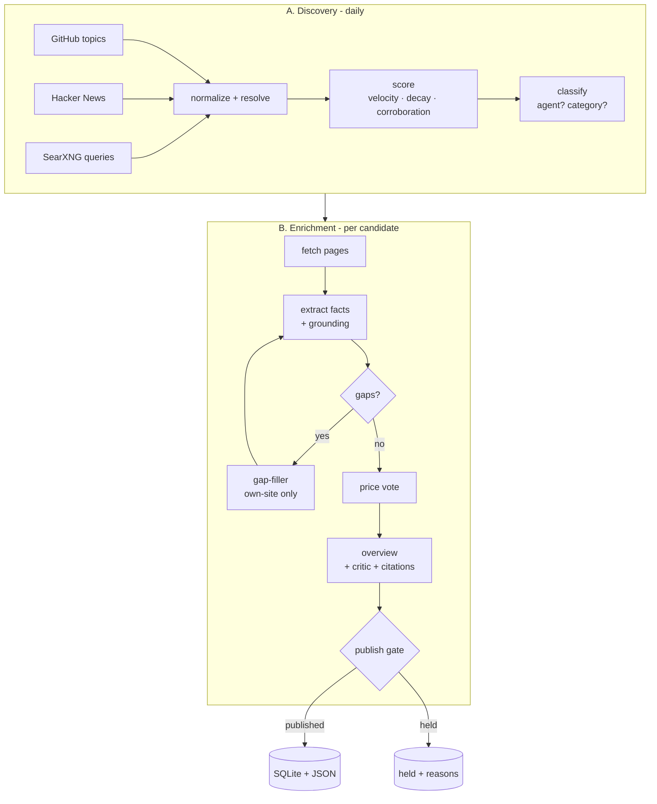

# Overview

The agent has two pipelines and a scheduler. Everything is plain Python on top of [AAA](../aaa/index.md); there is no framework of our own.

| Stage | Code | AAA piece |
|---|---|---|
| Collect + score | `discovery/workflow.py`, `scoring.py`, `ingest.py` | `WorkflowGraph` |
| Entity resolution | `discovery/resolve.py`, `semantic.py` | sqlite-vec store + `LLMEmbedder` |
| Classify | `discovery/classify.py` | `GenerateTestRepair`, `SelfConsistency` |
| Fetch | `tools/fetch_html.py`, `tools/github_meta.py` | `SafeFetcher`, single-tool graphs |
| Extract + verify | `enrich/extract.py`, `grounding.py` | `GenerateTestRepair` + validator |
| Fill gaps | `enrich/gapfill.py`, `tools/research.py` | bounded `ToolLoop` |
| Verify prices | `enrich/pricevote.py` | `SelfConsistency` |
| Overview | `enrich/overview.py` | `GeneratorCritic` |
| Gate + save | `enrich/assemble.py`, `db/repo.py` | plain code |

## Design principles

1. **Deterministic where possible.** Collection, scoring, merging, fetching, the gate: all code, no tokens.
2. **The model proposes, code disposes.** The LLM drafts claims; validators decide what survives.
3. **Evidence or nothing.** A listing field exists only if a quote on a fetched page supports it. Missing is `null`, never guessed.
4. **Fail closed, never downgrade.** Weak runs hold or keep the previous listing.
5. **Everything is replayable.** AAA's event log records each run; SQLite rows record every fetched page, signal and decision.

## Lifecycle of a candidate

`new` → `classified` (or `rejected`) → `enriching` → `published` or `held`. Held candidates keep their reasons in `publish_log`
(for example *only 1 evidenced features (need 3)*). A published listing is refreshed on a schedule and re-extracted only if its sources changed.
