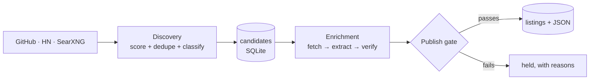

# BotsHub Agent

**An autonomous agent for [botshub.com](https://botshub.com) that finds which AI agents are getting popular and builds a directory listing for each one, using only facts it actually fetched.**

It is built on [**AAA, the Autonomous Agent Architecture library**](https://innerkorehq.github.io/AutonomousAgentArchitecture/)
(`pip install autonomous-agent-architecture`), and this site doubles as a worked, real-world example of using AAA:
every pipeline stage maps to an AAA algorithm, and the [lessons page](aaa/lessons.md) records what we learned running it against live services.

<div class="grid cards" markdown>

-   **:material-magnify: Finds what is trending**

    GitHub, Hacker News and SearXNG signals, stored with dates so we can compute star *velocity*, not just popularity.
    [Discovery →](agent/discovery.md)

-   **:material-shield-check: Never invents**

    Every claim in a listing carries a verbatim quote from a page we downloaded. A validator rejects anything it cannot find.
    [Grounding →](agent/enrichment.md)

-   **:material-sqlite: SQLite everywhere**

    Business data in one SQLite file, AAA's event log in another. One machine, crash-safe, no servers to run.
    [Data →](agent/data.md)

-   **:material-lightning-bolt: Built on AAA**

    `WorkflowGraph`, `GenerateTestRepair`, `GeneratorCritic`, `SelfConsistency` and `ToolLoop`, each used where it fits.
    [Using AAA →](aaa/index.md)

</div>

## What it produces

For each agent it finds (like [aiagentslist.com](https://aiagentslist.com/agents/whatsapp-mcp-by-timelinesai)-style listings):
name, website, overview, features, use cases, integrations, pricing, screenshots/videos and specs. Output is JSON per agent plus an index,
ready for botshub.com to consume. See [the export format](agent/data.md#export-format).



## Try it

```bash
git clone https://github.com/innerkorehq/botshub-agent && cd botshub-agent
uv sync --extra docs
cp .env.example .env     # add your LLM gateway key
uv run botshub discover && uv run botshub enrich --limit 3
```

Details in the [quickstart](run/quickstart.md). The project is **alpha**; see [status and known gaps](about/gaps.md) for what is and is not verified.

!!! info "About AAA"
    AAA is an async, event-driven Python library for the non-model parts of an agent system: loops, plans, routing, retries,
    budgets, approvals, persistence and recovery. Read its [documentation](https://innerkorehq.github.io/AutonomousAgentArchitecture/)
    or star it on [GitHub](https://github.com/innerkorehq/AutonomousAgentArchitecture).
